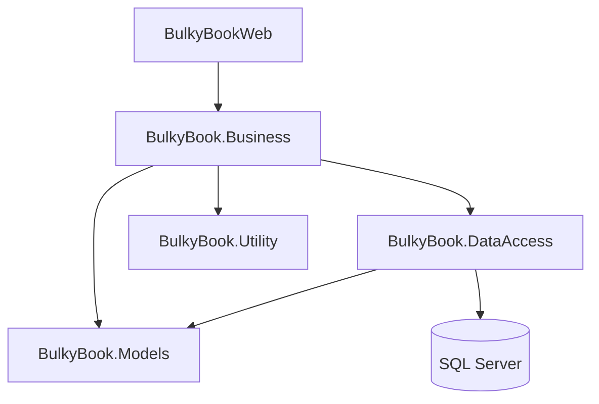
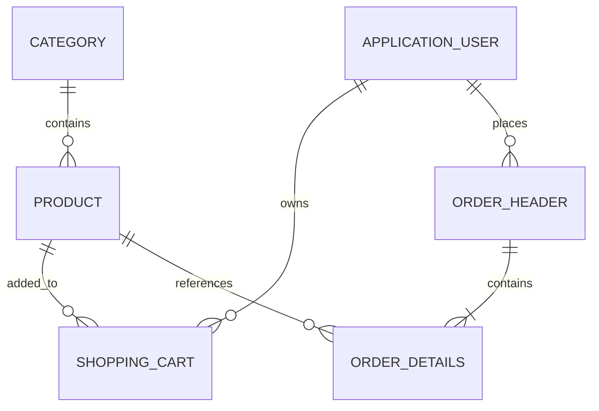

# 📚 BulkyBook – Online Bookstore

An online bookstore built with **ASP.NET Core MVC**, featuring product management, shopping cart, order processing, and secure online payments.

🌐 **Live Demo:** https://bulkybooktest.runasp.net/

💻 **GitHub:** https://github.com/MohamedAhmedHamza/BulkyBook

## ✨ Features

- User Authentication & Role-Based Authorization.
- Product and Category Management.
- Shopping Cart & Order Management.
- Stripe Payment Integration & Webhooks.
- Email Notifications using Mailjet.
- Password Reset using OTP Verification.
- Admin Dashboard and User Management.

## 🏗️ Architecture

The project follows a layered architecture:



| Project | Responsibility |
|---|---|
| BulkyBookWeb | MVC, Controllers & Views |
| BulkyBook.Business | Business Logic & Services |
| BulkyBook.DataAccess | EF Core, Repositories & Unit of Work |
| BulkyBook.Models | Entities & ViewModels |
| BulkyBook.Utility | Shared Constants & Utilities |

## 🗄️ Database Relationships



## 🛠️ Technologies

- C# / ASP.NET Core MVC / .NET 10
- Entity Framework Core / SQL Server
- ASP.NET Core Identity
- Repository Pattern & Unit of Work
- AutoMapper
- HTML / CSS / JavaScript / Bootstrap
- Stripe / Mailjet
- Git / GitHub
- MonsterASP Hosting

## 📸 Screenshots

Add screenshots to `docs/images/`:

| Home | Products |
|---|---|
|  |  |

| Cart | Admin Dashboard |
|---|---|
|  |  |

## 🚀 Run Locally

**Requirements:** .NET 10 SDK and SQL Server.

```bash
git clone https://github.com/MohamedAhmedHamza/BulkyBook.git
cd BulkyBook
dotnet restore
dotnet build
```

Configure the database connection and external service credentials, then run migrations:

```bash
dotnet ef database update --project BulkyBook.DataAccess --startup-project BulkyBookWeb
```

Run the application:

```bash
dotnet run --project BulkyBookWeb
```

## 🔐 Environment Variables

Configure the following settings:

- `ConnectionStrings__DefaultConnection`
- `Otp__Secret`
- Stripe API and webhook credentials.
- Mailjet API credentials and sender settings.

**Never commit secrets or connection strings to GitHub.**

## 👨‍💻 Author

**Mohamed Ahmed Hamza**

[GitHub Profile](https://github.com/MohamedAhmedHamza)

---

*ASP.NET Core MVC Online Bookstore – Full-Stack Development Project.*
